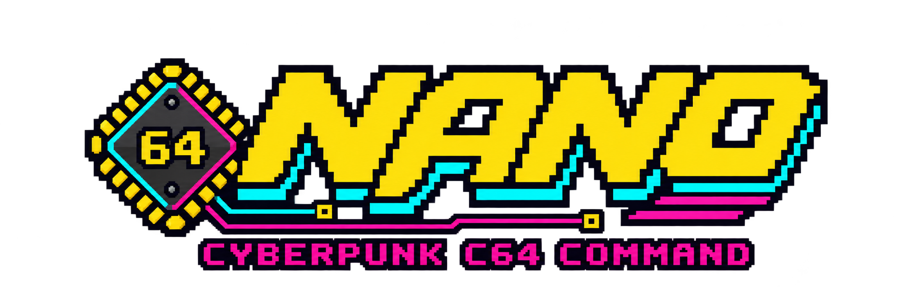

# CYBERPUNK C64 COMMAND NANO

**A little Mac companion for a big 8-bit world.**  
Drop a disk. Start a tune. Light up the night.

Made for **C64 Ultimate** and **Apple Silicon** by **Breadbin Runner**.

---

Some evenings call for a familiar blue screen, a favourite SID and one more disk flip.

NANO brings those moments closer. It is a compact macOS companion for your C64 Ultimate, built with pixel art, neon colours and a soft spot for the scene. Connect your Mac, pick a file and get back to exploring.

## The deck

- **Media launcher** — Open D64, D71 and D81 disk images, PRG programs, CRT cartridges and SID files from your Mac or Ultimate.
- **Disk Flip** — Keep multiple disks in a stack, switch between them with custom shortcuts and save sessions for later.
- **Disk directory** — Browse disk images and open an individual program or recognised SID tune.
- **SID player** — Listen on your Mac or send a tune to the Ultimate. Choose a subtune and, for supported tunes, a SID chip and music-reactive lighting.
- **World Radio** — Launch the radio on the C64 and choose stations there. NANO offers temporary audio and lighting settings for the session.
- **Live keyboard** — Type on your Mac and send C64 keys to the Ultimate.
- **At a glance** — Find your Ultimate on the local network and see its connection and selected KERNAL ROM status.
- **Your language** — Switch between German and English in the settings.

## Downloads

Download the macOS version for Apple Silicon from [Releases](https://github.com/breadbin-runner/cyberpunk-c64-command-nano/releases/latest). A Windows version is planned and will follow.

The current Mac build is ad-hoc signed and is not notarized by Apple. macOS may require approval in **Privacy & Security** before opening it.

## Manuals

Take NANO with you on your next C64 session. The illustrated guides cover setup, disks, SID music, World Radio and more.

- [Deutsches Handbuch (PDF)](NANO-Handbuch-DE.pdf)
- [English user guide (PDF)](NANO-User-Guide-EN.pdf)

## Getting connected

Open NANO, choose **Connect** and enter your C64 Ultimate’s address. Enable local network access and Web Remote Control for the connection. FTP is needed to browse files stored on the Ultimate.

Keep NANO running on your Mac while listening to World Radio. The C64 radio menu handles station selection and playback. The setup dialog shows any temporary Ultimate configuration changes before applying them.

## A few things to know

NANO can start or reset the C64 when launching media. Stopping SID playback on the Ultimate reboots the C64. Save your work first.

Music-reactive lighting depends on your Ultimate configuration and the tune. Manual SID-chip selection with lighting currently supports mono SID tunes. Stereo and multi-SID tunes use the Ultimate’s automatic configuration. The Ultimate menu screen and live keyboard require compatible firmware. Some RSID files played on the Mac require your own KERNAL, BASIC and CHARGEN ROM files.

World Radio, SID routing and lighting are evolving. Hardware setups differ, so your reports help make NANO better.

## Behind the pixels

NANO is an independent companion project by **Breadbin Runner**, created alongside [Cyberpunk C64 Command](https://github.com/breadbin-runner/cyberpunk-c64-command). It has its own app identity and settings.

Built for the people who still enjoy the sound of a SID, the character of a breadbin and the joy of discovering something new on a 40-column screen.

## Disclaimer

Cyberpunk C64 Command NANO is an independent fan project by Breadbin Runner, made for the community. It is not affiliated with or endorsed by the owners of the Commodore or C64 Ultimate brands. All trademarks belong to their respective owners.

This software is provided **“as is,” without warranty**. Use it at your own risk. To the fullest extent permitted by applicable law, Breadbin Runner is not liable for any damage or loss arising from its use. This disclaimer does not exclude liability that cannot be excluded by law.

## Say hello

Found a bug, have an idea or want to share your setup? Open an issue here on GitHub. Include your NANO version, Ultimate firmware version and a short description of what happened.

If NANO makes your retro nights a little brighter, you can support the project through the PayPal QR code in the app’s **Info** window.

---

**SEE YOU ON THE C64.**  
Made with care for the community · Breadbin Runner

## Windows version – FTP setup (English) - In the next update, NANO will automatically use the C64 Ultimate’s detected hostname for the FTP username, so you won’t need to enter it manually.

1. On your C64 Ultimate, open **Network Services & Timezone**. Enable **FTP File Service** and note the **Hostname**, for example `my-c64`.
2. In NANO, open **Settings** and expand **FTP login for Ultimate storage**.
3. In the username field, labelled **Benutzer** in NANO 0.1.15, replace `anonymous` with the hostname shown on your Ultimate. Leave **Port** at `21` unless your configuration uses another port.
4. Enter your FTP password if you configured one on the Ultimate. Otherwise, leave the field empty.
5. Click **Save**, then select **Ultimate** on the NANO home screen to browse your files.

## Windows-Version – FTP-Einrichtung (Deutsch) - Im nächsten Update wird NANO automatisch den vom C64 Ultimate erkannten Hostnamen als FTP-Benutzernamen verwenden, sodass Sie ihn nicht mehr manuell eingeben müssen.

1. Öffne am C64 Ultimate **Network Services & Timezone**. Aktiviere **FTP File Service** und merke dir den **Hostname**, zum Beispiel `mein-c64`.
2. Öffne in NANO die **Einstellungen** und klappe **FTP-Anmeldung für den Ultimate-Speicher** auf.
3. Ersetze im Feld **Benutzer** den Eintrag `anonymous` durch den Hostnamen deines Ultimate. Lass den **Port** auf `21`, sofern du keinen anderen Port eingerichtet hast.
4. Wenn du am Ultimate ein FTP-Passwort eingerichtet hast, gib es ein. Ansonsten bleibt das Feld leer.
5. Klicke auf **Speichern** und anschließend auf der Startseite auf **Ultimate**, um deine Dateien zu öffnen.
